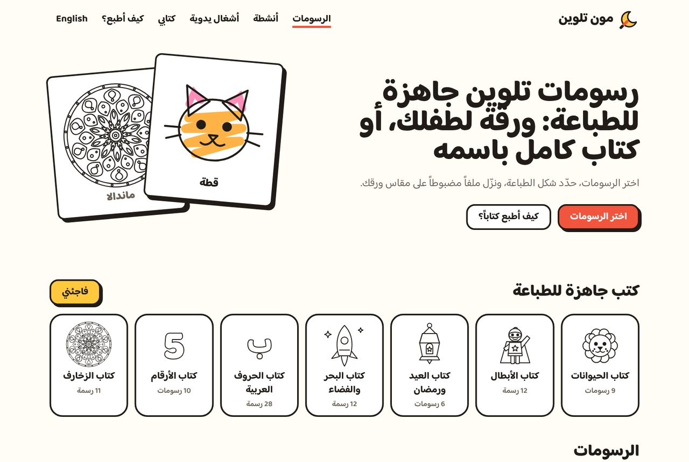
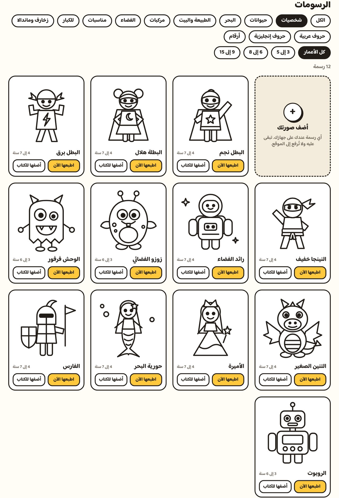
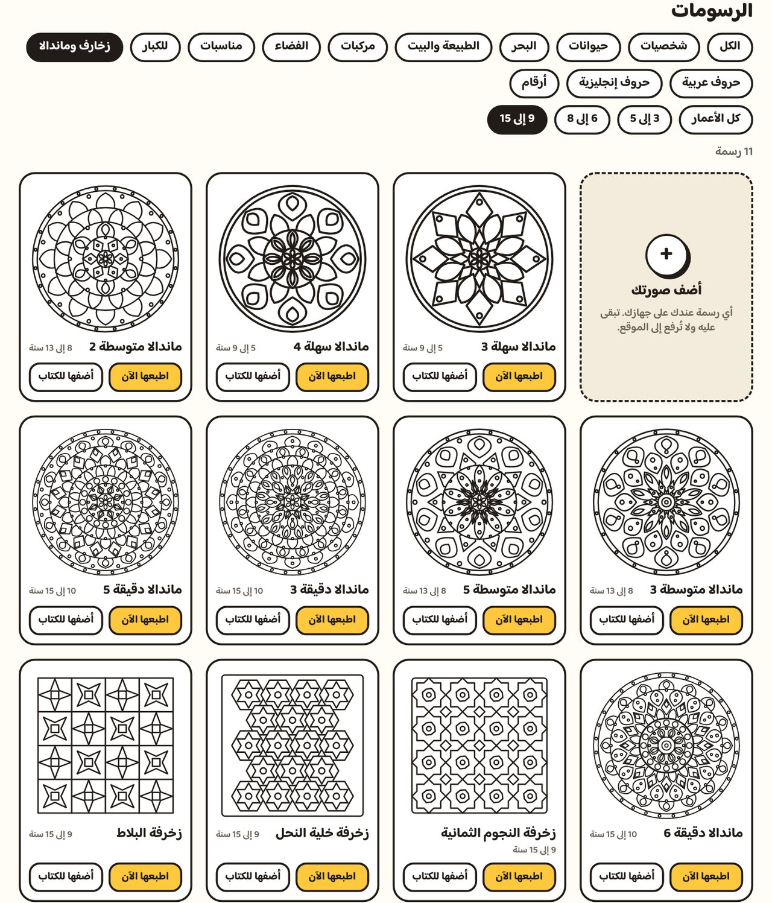
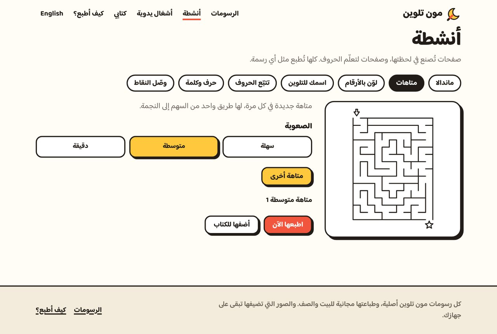
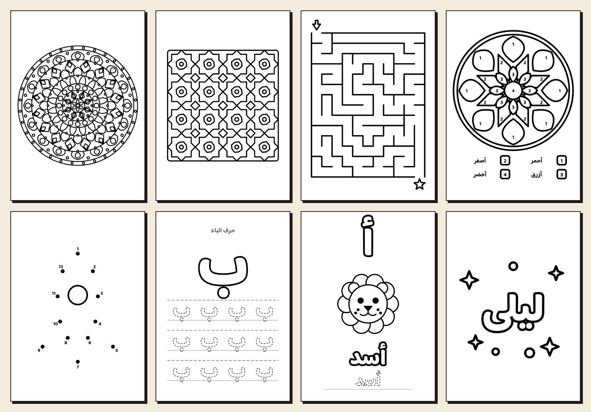
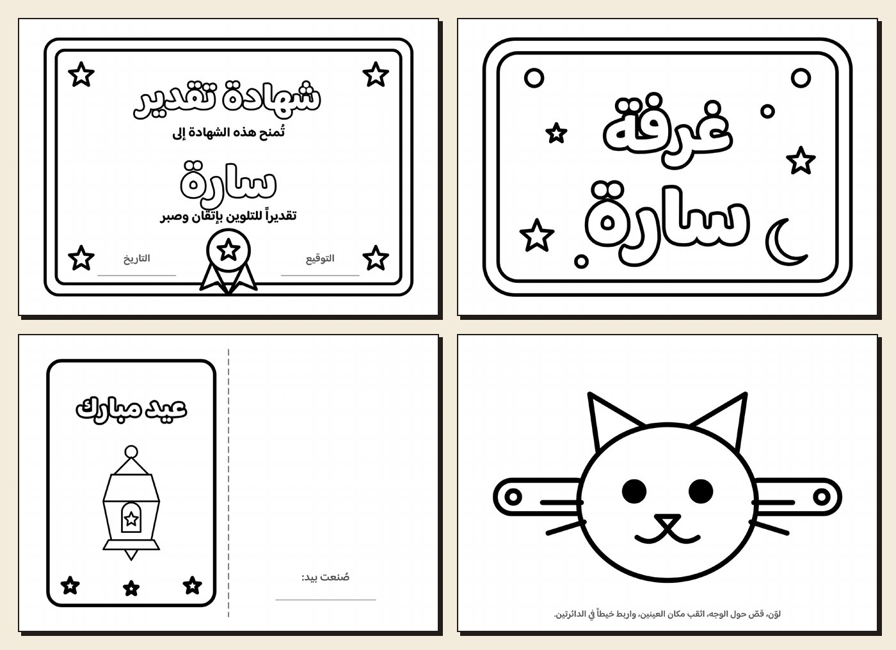
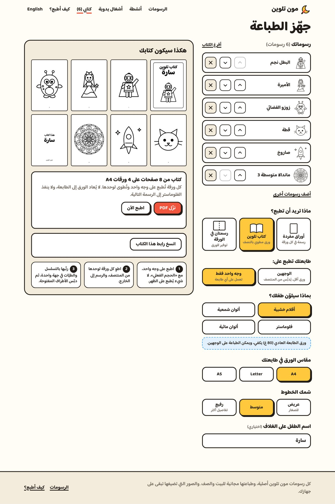
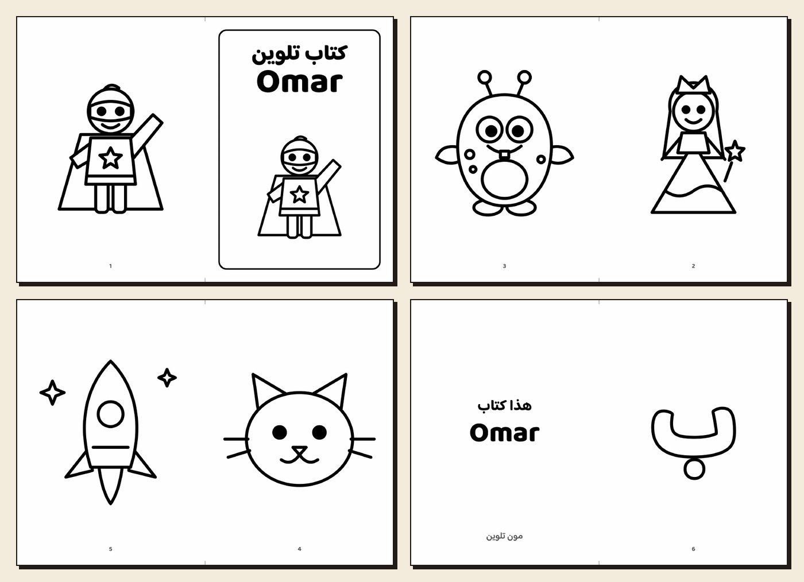
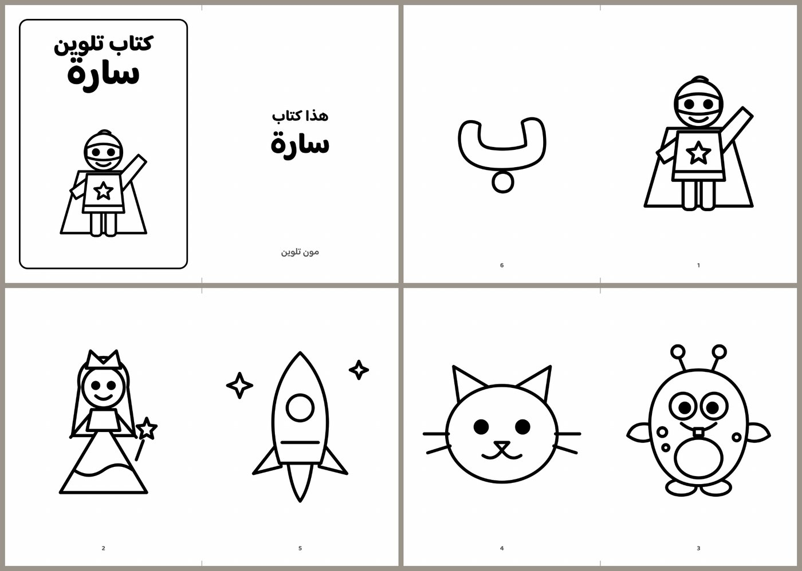

# Moon Talween (مون تلوين)

Coloring pages for children, ready to print, in Arabic and English. Pick drawings, say how you want them printed, and get a file made for your paper: one sheet that fills the page, two drawings to a sheet, or a whole coloring book with the child's name on the cover.

**Live site:** https://moon-talween.vercel.app (Arabic), https://moon-talween.vercel.app/en (English)

Everything runs in the browser. There is no server, and pictures you add never leave your device.



## What it does

### Drawings

- **52 original drawings** in eight groups: characters, animals, the sea, nature and home, vehicles, space, occasions (a lantern, a crescent, a mosque, a cake and more) and things for older children (a controller, a sneaker, headphones, a guitar and more).
- **Mandalas and patterns** for older children, up to 15: eight mandalas in three levels of detail, and star, honeycomb and tile patterns.
- **A page for every letter and number:** the 28 Arabic letters, A to Z, and 0 to 9, each as one large outline.
- **Filter by age:** three ranges, the oldest 9 to 15.
- **Add your own picture.** Any picture on your device can be printed the same way as the site's drawings. It is opened by the browser only and is gone when the page is closed.





### Activities

Pages the site makes on request. Each one can be printed alone or added to a book.

- **Mandalas:** pick a level and press "another one" for a new one each time.
- **Mazes** in three sizes, always with exactly one way through.
- **Color by number,** with the key of colors printed under the drawing.
- **A name to color:** type any name and get it as large outlined letters.
- **Tracing:** a letter or a number with dotted copies to write over.
- **A letter and a word:** the letter, a drawing that starts with it, and the word to trace.
- **Dot to dot:** eight shapes.





### Crafts

Whole sheets to color and then cut or fold: a certificate and a door sign with the child's name, four greeting cards, two sheets of bookmarks and four masks.



### Printing

- **One drawing, now.** Fill the sheet, or keep a margin with the drawing's name under it. A line for the child's name can be added at the top, for a class.
- **Two a sheet,** with a dashed line to cut along.
- **A coloring book.** Sheets folded in half. The site puts every page where it has to go, so the folded stack reads in order, opening from the right in Arabic and from the left in English.
- **A printer that prints one side only** still gets a book: each sheet carries two pages on one side, is folded on its own with the print outside, and the sheets are stapled at their open edges.
- **Ready-made books:** seven sets (animals, heroes, Eid and Ramadan, sea and space, and more), and "surprise me" for a random one.
- **Share a book by link.** The link carries the chosen drawings and settings, nothing else. Pictures you added are not in it.
- **What will the child color with?** Pencils and crayons print on both sides. Felt pens and watercolors soak through, so in a two-sided book each drawing gets a leaf of its own, and the site says which paper to use.
- **Paper:** A4, Letter or A5. **Lines:** thick for little ones, medium or thin.
- **Print directly or download a PDF.** Both come from the same pages, and the previews on screen are drawn by the same code, so what you see is what prints.







## How it is built

- [React 18](https://react.dev) with [Vite](https://vite.dev), [React Router 7](https://reactrouter.com) and [Tailwind CSS 3](https://tailwindcss.com)
- No backend and no other dependencies: the page layout, the booklet ordering and the PDF file are written in this repository

Some decisions worth knowing:

- **A drawing is a few lines of SVG** in a 200 by 200 box (`src/drawings/`). Shapes are white with a black outline unless marked as an open line or a solid dot, which keeps every area closed and ready to color.
- **Made pages come from a short reference** such as `maze-12-2` or `mandala-5-3` (`src/makers/`). The same reference always gives the same page, so a made page can sit in a book, in a link, or in the address bar. Typed names are cleaned before they are used.
- **Planning is separate from drawing.** `plan()` in `src/lib/plan.js` takes the chosen drawings and settings and returns plain data: the pages, their size in millimetres, and what sits in each rectangle. It can be tested without a browser.
- **Booklet order.** For a book of N pages, sheet k carries pages N−2k and 2k+1 on one side and 2k+2 and N−2k−1 on the other. A test folds the sheets in code and checks the pages come out 1, 2, 3 and so on, for both reading directions.
- **One renderer.** `src/lib/render.js` draws a planned page on a canvas. It makes the small previews at screen size and the printed pages at 200 dots per inch.
- **The PDF is written by hand** (`src/lib/pdf.js`): each page is one JPEG at the page's real size, wrapped in the few objects a PDF needs.
- **Printing** places the same page pictures in the document where only the printer sees them, and sets the paper size to match.
- **Letters are type, not drawings.** Each is one glyph outlined at double width and then filled, which gives a clean outline and hides the places where a letter's own strokes overlap.

## Run it locally

```bash
npm install
npm run dev
```

Then open http://localhost:5173.

## Limits

- Printers differ in how close to the edge they can print. Pages keep 7 mm clear, and "actual size" must be chosen in the print window.
- Printing a book on both sides needs "flip on short edge". For a printer that prints one side only, choose "one side only" in the book settings.
- Whole-sheet pages (cards, masks, certificates, bookmarks) print on their own and are left out of books.
- The pages were checked as PDF files on screen, not on a real printer.
- Pictures you add are kept only while the page is open.
